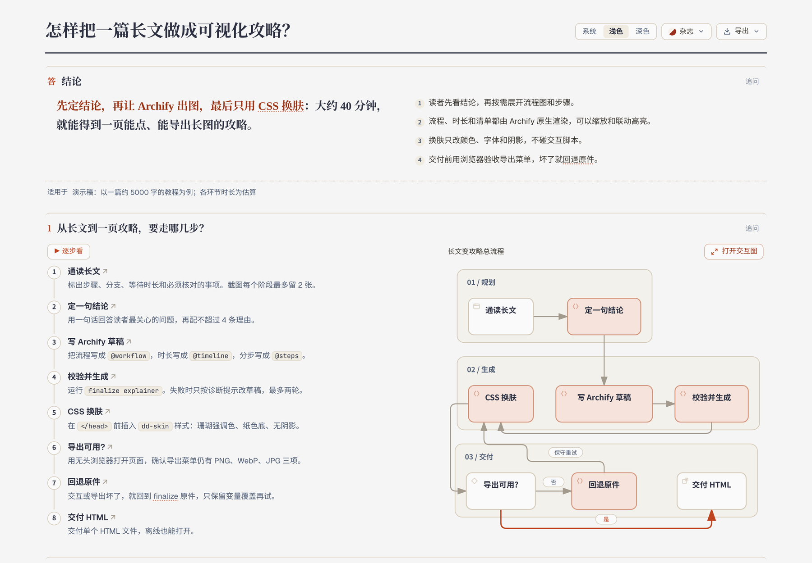
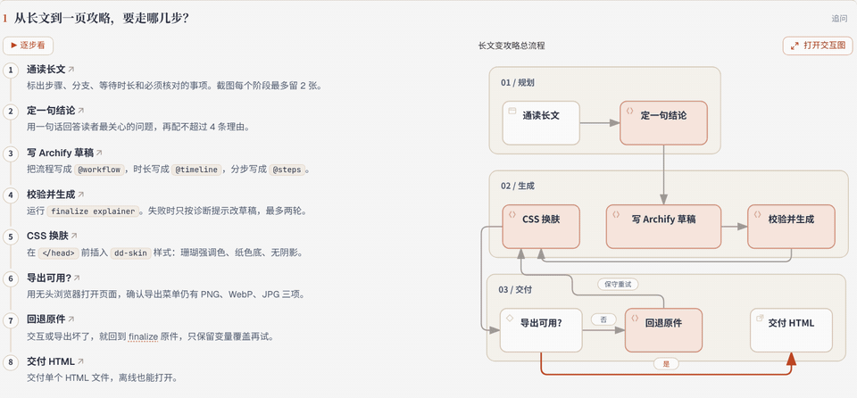
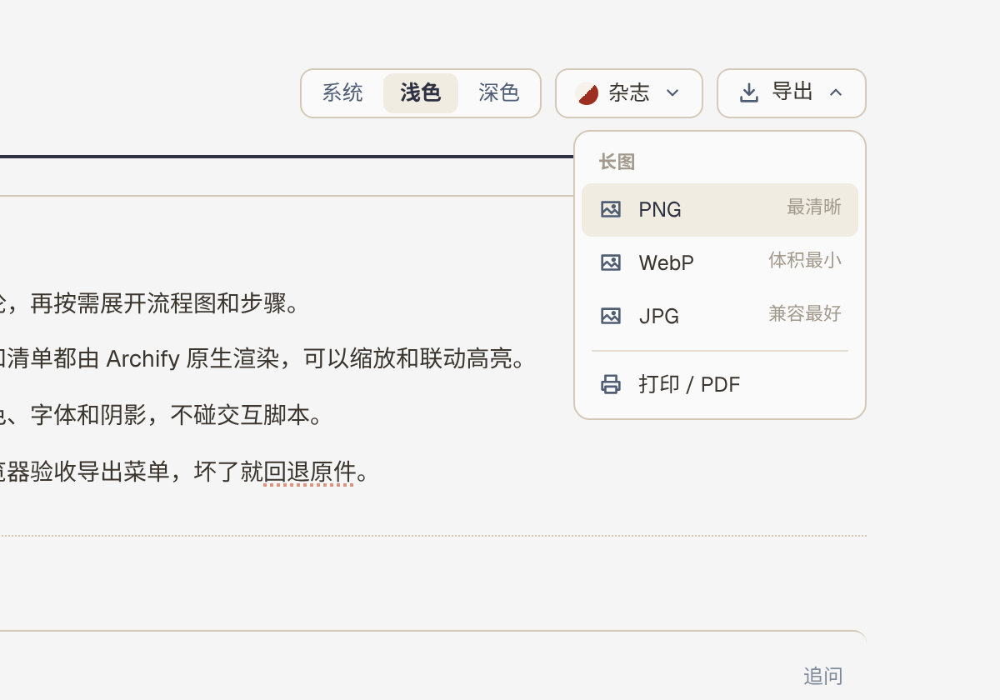
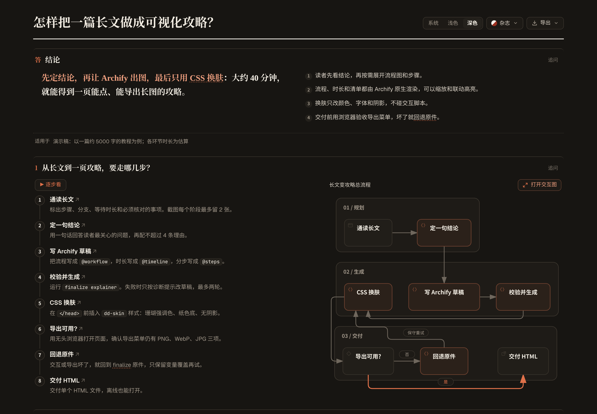
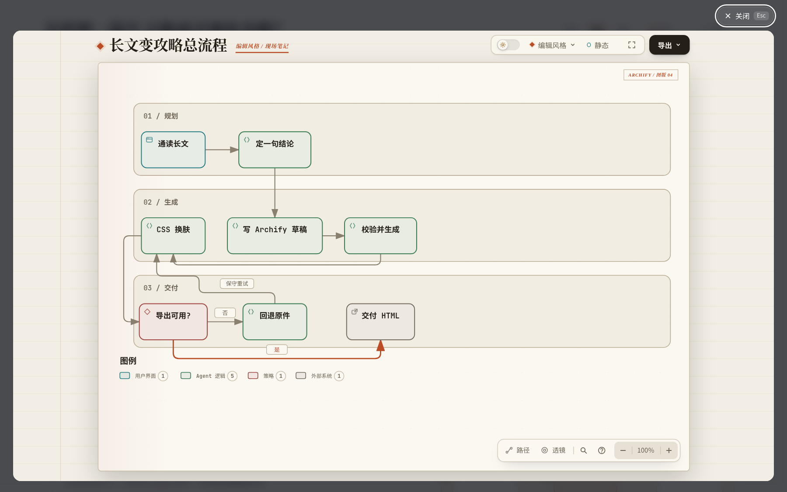
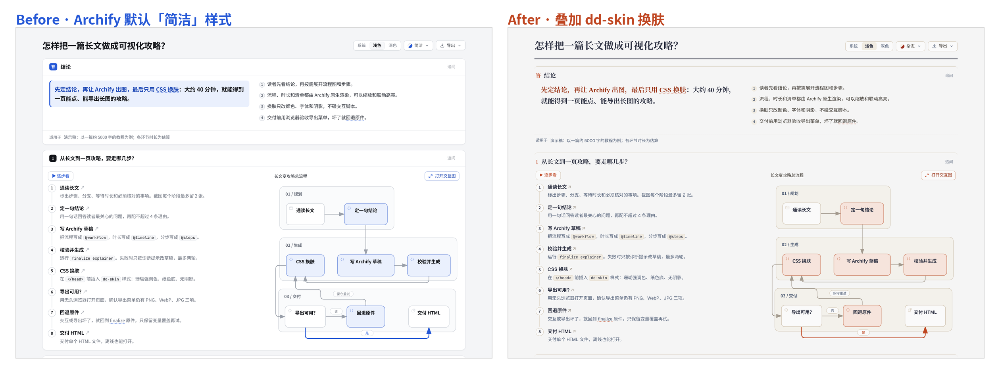
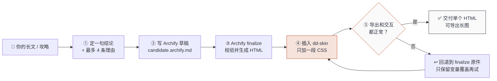
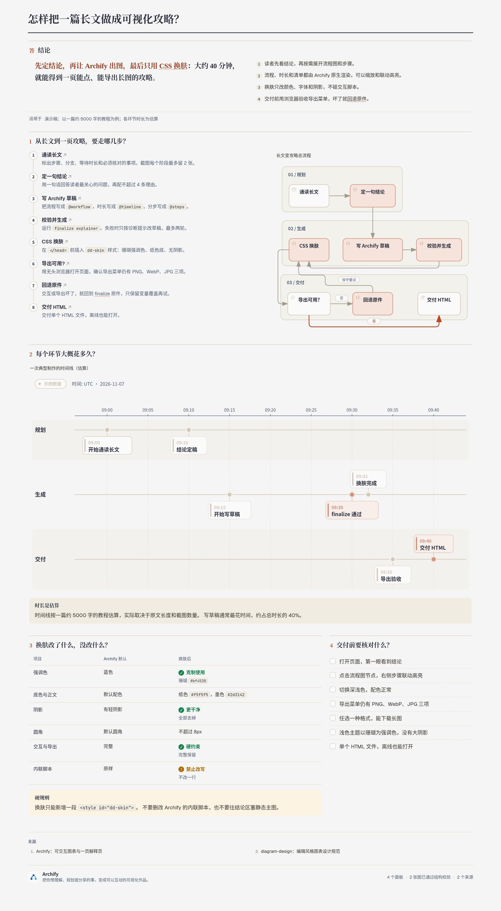

<div align="center">

# 攻略可视化 · archify-diagram-design

**把一篇长文、攻略或教程，交给 AI 做成一页能点、能切深浅色、能导出长图的 HTML。**

[](LICENSE)
[](SKILL.md)
[](#-安装)
[](https://github.com/tt-a1i/archify)
[](CHANGELOG.md)

中文 · [English](README_EN.md)



<sub>上图是本仓库自带示例的真实截图，打开 <a href="examples/longform-guide/longform-guide.html"><code>examples/longform-guide/longform-guide.html</code></a> 就能看到同样的页面。</sub>

</div>

---

## 目录

- [这是什么](#-这是什么)
- [功能亮点](#-功能亮点)
- [换肤前后对比](#-换肤前后对比)
- [它是怎么工作的](#-它是怎么工作的)
- [准备工作（小白必读）](#-准备工作小白必读)
- [安装](#-安装)
- [怎么用](#-怎么用)
- [你会得到什么](#-你会得到什么)
- [交付前验收清单](#-交付前验收清单)
- [常见问题](#-常见问题)
- [仓库结构](#-仓库结构)
- [致谢](#-致谢)
- [许可证](#-许可证)

## 💡 这是什么

这是一个给 AI 编程助手（Codex、Claude Code、Cursor 等）用的**技能（Skill）**。技能就是一份写给 AI 看的“操作手册”：装好以后，你只要说一句“把这篇文章做成一页可视化攻略”，AI 就会按手册一步步做完。

它把两个开源技能组合在一起，各管一件事：

| 谁 | 负责什么 |
| --- | --- |
| [**Archify**](https://github.com/tt-a1i/archify) | 页面骨架和交互：结论先行、可点的流程图 / 时间线 / 分步、深浅色切换、**PNG / WebP / JPG 长图导出** |
| [**diagram-design**](https://github.com/cathrynlavery/diagram-design) | 只负责“换皮肤”：珊瑚色强调 `#bf4520`、纸色底、墨色字、无阴影、小圆角、中文友好字体 |

> **一条硬规则：换肤绝不能破坏交互和导出。** 皮肤只是一段 CSS，不改 Archify 的任何脚本。

## ✨ 功能亮点

- **结论先行**：打开页面第一眼就是一句话结论，加最多 4 条理由。
- **能点的流程图**：步骤、分支（比如“导出可用？是 / 否”）都画成真正的交互图，可缩放、可搜索、可看路径。
- **逐步讲解**：点“▶ 逐步看”，左边步骤和右边流程图节点同步高亮。
- **时间线**：每一步大概花多久，用时间线画出来；估算值会明确标成估算。
- **深浅色切换**：浅色、深色、跟随系统，三种都能用。
- **一键导出长图**：PNG（最清晰）、WebP（体积最小）、JPG（兼容最好），另有“打印 / PDF”。
- **单个 HTML 文件**：不用服务器，双击就能打开，断网也能看，发给别人也方便。
- **克制的视觉**：珊瑚色只点在重点上，去掉所有阴影，不再是默认的“蓝色科技风”。

<table>
<tr>
<td width="50%"><br><sub>“逐步看”：每一步都和图上的节点联动高亮</sub></td>
<td width="50%"><br><sub>换肤后导出菜单完整保留：PNG / WebP / JPG / 打印</sub></td>
</tr>
<tr>
<td width="50%"><br><sub>深色模式：只换强调色，底色沿用 Archify 深色主题</sub></td>
<td width="50%"><br><sub>点“打开交互图”：全屏查看器，可缩放、搜索、看路径</sub></td>
</tr>
</table>

## 🎨 换肤前后对比

左边是 Archify 默认的“简洁”样式（蓝色强调），右边是叠加本技能皮肤后的样子。内容、交互、导出完全一样，变的只有颜色、字体、阴影和圆角。



| 项目 | Archify 默认 | 换肤后 |
| --- | --- | --- |
| 强调色 | 蓝色 `#2457d6`（“简洁”样式） | 珊瑚色 `#bf4520`，只用在重点上 |
| 底色 / 文字 | 各样式自带配色 | 纸色 `#f5f5f5` / 墨色 `#2d3142` |
| 阴影 | 有轻阴影 | 全部去掉 |
| 圆角 | 默认圆角 | 不超过 8px |
| 字体 | 系统字体 | Geist / 思源黑体 / 苹方；标题用衬线体 |
| 交互与导出 | 完整 | **完整保留** |

## 🔧 它是怎么工作的



简单说：**内容和交互全交给 Archify，好看交给一段 CSS，最后一定要验收导出。**

## 🧰 准备工作（小白必读）

用这个技能之前，电脑上需要有三样东西。不用担心，每样都只装一次。

### 1. Node.js（运行 Archify 需要）

Node.js 是一个运行 JavaScript 程序的工具，Archify 的命令行就靠它运行。需要 **18 或更高版本**。

- 打开“终端”（Mac：按 `Cmd + 空格`，输入“终端”回车；Windows：开始菜单搜“PowerShell”）。
- 输入下面的命令看看有没有装：

```bash
node -v
```

- 显示 `v18.x.x` 或更高就可以了。显示“找不到命令”的话，去 [nodejs.org](https://nodejs.org/) 下载 **LTS** 版本，像普通软件一样安装，然后**重新打开终端**。

### 2. 一个 AI 编程助手

任选一个就行：

| 助手 | 说明 |
| --- | --- |
| [Codex](https://developers.openai.com/codex)（OpenAI） | 命令行或 App 都可以 |
| [Claude Code](https://docs.anthropic.com/en/docs/claude-code)（Anthropic） | 命令行 |
| [Cursor](https://cursor.com/) | 在 Agent 对话里使用 |

> 其他支持 Agent Skills 的助手（例如读取 `~/.agents/skills/` 目录的工具）一般也能用。

### 3. Archify 技能（必装）

本技能依赖 Archify 生成页面。在终端运行：

```bash
npx skills add tt-a1i/archify -g
```

装完后，Archify 一般会在 `~/.agents/skills/archify`（或 `~/.claude/skills/archify`）。技能会自动去这些位置找它。

### 4. diagram-design 技能（可选）

本技能已经**自带**了 diagram-design 风格的皮肤文件 `assets/dd-skin.css`，所以 diagram-design **不是必装**。如果你还想单独用它画图，可以装：

```bash
npx skills add cathrynlavery/diagram-design
```

## 📦 安装

### 方法一：一条命令安装（推荐）

在终端里，按你用的助手复制对应的一行：

```bash
# Codex（装到 ~/.agents/skills，Codex 会自动读取）
npx skills add bingomu/archify-diagram-design -g -a codex -y

# Claude Code（装到 ~/.claude/skills）
npx skills add bingomu/archify-diagram-design -g -a claude-code -y

# Cursor（装到 ~/.agents/skills）
npx skills add bingomu/archify-diagram-design -g -a cursor -y
```

看到 `✓ archify-diagram-design` 就是装好了。装完**重启一下你的 AI 助手**，让它重新加载技能。

### 方法二：用 git 手动安装

如果你想自己放到指定目录，把下面三行里**选一行**复制到终端：

```bash
# 通用位置（Codex、Cursor 等都会读取）
git clone https://github.com/bingomu/archify-diagram-design ~/.agents/skills/archify-diagram-design

# Codex 的专用目录
git clone https://github.com/bingomu/archify-diagram-design ~/.codex/skills/archify-diagram-design

# Claude Code 的专用目录
git clone https://github.com/bingomu/archify-diagram-design ~/.claude/skills/archify-diagram-design
```

> 没装 git？Mac 第一次运行 `git` 时会提示安装开发者工具，点“安装”即可；Windows 可以去 [git-scm.com](https://git-scm.com/) 下载。也可以在本页点绿色的 **Code → Download ZIP**，解压后把文件夹改名为 `archify-diagram-design`，放进上面任一目录。

### 怎么确认装好了

- 最简单的办法：重启助手后直接问它“你能用 archify-diagram-design 技能吗？”，它能说出技能的用途就是装好了。
- 也可以看文件在不在：终端运行 `ls ~/.agents/skills/archify-diagram-design`（Claude Code 换成 `~/.claude/skills/...`），能看到 `SKILL.md` 就对了。

### 更新

```bash
npx skills update archify-diagram-design -g
# 或者用 git 安装的：
cd ~/.agents/skills/archify-diagram-design && git pull
```

## 🚀 怎么用

把文章内容（或文件路径、链接）发给 AI，再加一句话就行。可以直接复制下面的提示词：

```text
用 archify-diagram-design 技能，把下面这篇教程做成一页可视化攻略：
结论先行，主流程画成流程图，每一步配说明，最后给我一份检查清单。
做完帮我验收导出菜单（PNG / WebP / JPG）能用。

<这里粘贴文章全文，或写文件路径 / 链接>
```

更多例子：

```text
把 ~/Downloads/新手入门.md 做成一页攻略 HTML，要能导出长图发朋友圈。
```

```text
这篇文章里有很多“等几天”的步骤，帮我把等待时间画成时间线，估算的地方标清楚。
```

```text
把这份操作手册做成一页，内容有分支的地方用判断节点（是 / 否）画出来。
```

AI 会按 [`SKILL.md`](SKILL.md) 里的五步走：**定结论 → 写 Archify 草稿 → finalize 生成 → CSS 换肤 → 验收导出和交互**。

### 想自己动手？

如果你已经有了 Archify 生成的 HTML，也可以只用本仓库的脚本给它换肤：

```bash
node ~/.agents/skills/archify-diagram-design/scripts/apply-skin.mjs out.html skinned.html
```

脚本只会在 `</head>` 前插入一段 `<style id="dd-skin">`，并且**拒绝覆盖原文件**，方便出问题时回退。

## 📄 你会得到什么

一次完整运行后，工作目录里通常有：

```text
.archify/explainer-<主题>-<日期时间>/
├── candidate.archify.md   ← 内容唯一来源（草稿）
├── out.html               ← Archify finalize 原件（出问题时回退用）
└── skinned.html           ← 换肤后的最终页面（交给你的就是它）
```

- 最终页面是**一个 HTML 文件**，双击用浏览器打开即可。
- 页面右上角“导出”可以生成整页长图。下面是示例页面直接点“导出 → JPG”得到的真实长图（已缩小）：

<details>
<summary>📷 点开查看导出的长图</summary>



</details>

### 自带示例

[`examples/longform-guide/`](examples/longform-guide/) 里有一个完整示例，主题是“怎样把一篇长文做成可视化攻略？”：

| 文件 | 说明 |
| --- | --- |
| [`candidate.archify.md`](examples/longform-guide/candidate.archify.md) | Archify 草稿，演示 `@workflow`（含判断节点）、`@timeline`、`@steps`、表格、提示框、检查清单 |
| [`longform-guide.html`](examples/longform-guide/longform-guide.html) | 换肤后的最终页面 |
| [`longform-guide.archify-original.html`](examples/longform-guide/longform-guide.archify-original.html) | Archify 原件，用来对比 |

> GitHub 网页上点 HTML 只会显示源码。请**下载**后用浏览器打开，或者 clone 仓库后双击打开。

## ✅ 交付前验收清单

技能要求 AI 交付前用浏览器逐项检查。你自己打开页面也可以对着点一遍：

- [ ] 打开即见结论
- [ ] 点流程图 / 时间线，能缩放、能联动步骤高亮
- [ ] 切换浅色 / 深色，配色正常
- [ ] 右上角“导出”菜单里有 **PNG / WebP / JPG** 三项
- [ ] 任选一种格式，能下载长图
- [ ] 浅色主题以珊瑚色为重点，不是蓝色科技风；没有大阴影
- [ ] 估算值和原文笔误都有标注
- [ ] 单个 HTML 文件，断网也能打开

本仓库示例页面已用无头 Chrome 跑过上面的检查：导出菜单三项都在，三种格式都成功下载了长图；“逐步看”8 步全部联动；交互图查看器能打开；深色模式正常；页面上没有任何元素带阴影。

## ❓ 常见问题

<details>
<summary><b>换肤后“导出”点不了，或者导出的图是空白的？</b></summary>

马上**回退到 finalize 原件**（`out.html`），只保留最保守的颜色变量覆盖再试一次。不要靠往页面里塞静态图片来“补”。本仓库的 `scripts/apply-skin.mjs` 会另存新文件，原件一直都在。
</details>

<details>
<summary><b>深色模式背景变成了浅色，文字看不清？</b></summary>

这是皮肤把浅色变量写在了 `:root` 上导致的。浅色变量只能写在 `html[data-theme="light"], html:not([data-theme="dark"])` 下。直接用本仓库的 `assets/dd-skin.css` 就不会有这个问题。
</details>

<details>
<summary><b>AI 说找不到 Archify / <code>archify.mjs</code>？</b></summary>

先确认装了 Archify：`npx skills add tt-a1i/archify -g`。然后看看下面哪个目录存在：`~/.agents/skills/archify`、`~/.codex/skills/archify`、`~/.claude/skills/archify`。把实际路径告诉 AI 即可。
</details>

<details>
<summary><b>提示 <code>node: command not found</code>？</b></summary>

还没装 Node.js，或者装完没重开终端。去 [nodejs.org](https://nodejs.org/) 装 LTS 版本，然后关掉终端重新打开。
</details>

<details>
<summary><b>finalize 报错了怎么办？</b></summary>

Archify 的报错会写明哪一行、什么问题、怎么修。技能要求 AI 只按报错里的修复建议改草稿，最多改两轮。常见原因：正文里直接写了 `<`、`>` 或 `*`（要用反引号包起来），或者表格行的格子数不对。
</details>

<details>
<summary><b>在 GitHub 上点开 HTML 只看到一堆代码？</b></summary>

GitHub 不会直接运行 HTML。点文件页面右上角的下载按钮，存到电脑上再双击打开。
</details>

<details>
<summary><b>可以换成别的颜色吗？</b></summary>

可以。复制一份 `assets/dd-skin.css`，改里面的 `--accent` 等变量，再用 `node scripts/apply-skin.mjs out.html skinned.html 你的皮肤.css` 插入。改完记得重新验收导出。
</details>

<details>
<summary><b>什么时候不适合用这个技能？</b></summary>

- 纯代码架构深挖：直接用 Archify 的原生图。
- 只要一张静态海报、不要交互：直接用 diagram-design。
- 仪表盘：两者都不适合。
</details>

## 🗂 仓库结构

```text
archify-diagram-design/
├── SKILL.md                     # 技能本体：写给 AI 的工作流和硬规则
├── assets/
│   └── dd-skin.css              # diagram-design 风格皮肤（只有 CSS）
├── scripts/
│   └── apply-skin.mjs           # 把皮肤插入 Archify HTML 的小脚本
├── examples/
│   └── longform-guide/          # 完整示例：草稿 + 原件 + 换肤后页面
├── docs/images/                 # README 用到的截图
├── README.md / README_EN.md     # 中文 / 英文说明
├── CHANGELOG.md
└── LICENSE                      # MIT
```

## 🙏 致谢

- [**Archify**](https://github.com/tt-a1i/archify)（作者 tt-a1i，Apache-2.0）：页面结构、交互图、深浅色和长图导出全部来自它。`examples/` 里的 HTML 内嵌了 Archify 运行时，这部分按 Apache-2.0 授权，版权归 Archify 作者所有。
- [**diagram-design**](https://github.com/cathrynlavery/diagram-design)（作者 Cathryn Lavery，MIT）：本技能借用它的视觉规范，包括珊瑚色 `#bf4520`、纸色 `#f5f5f5`、墨色 `#2d3142`、无阴影和“少即是多”的取舍原则。

本项目与上述项目没有官方关联。

## 📜 许可证

本仓库自己的内容（`SKILL.md`、`assets/`、`scripts/`、文档和示例草稿）使用 [MIT](LICENSE) 许可证。第三方部分保留各自的许可证，见上方[致谢](#-致谢)。
