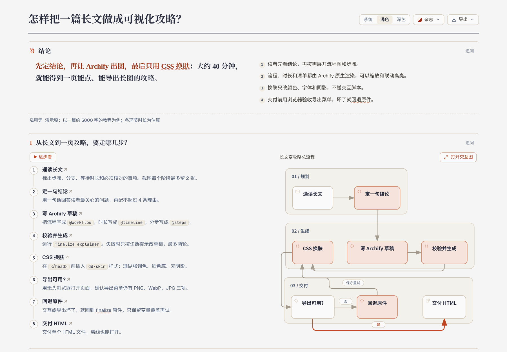
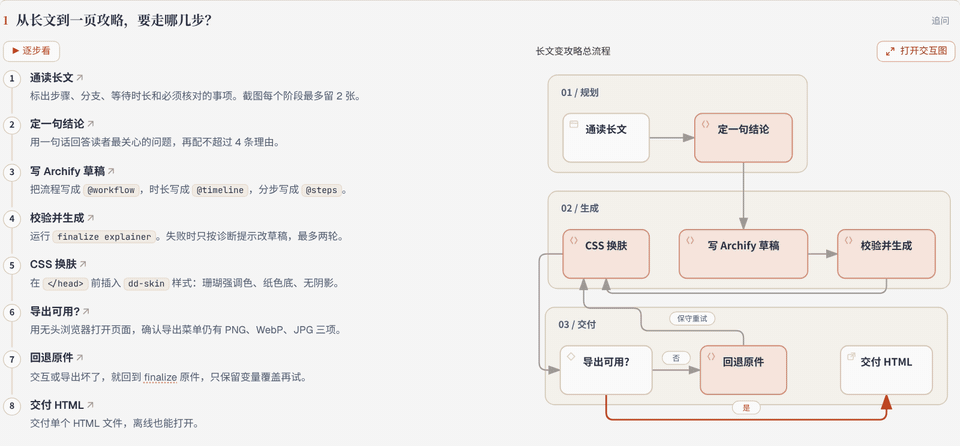
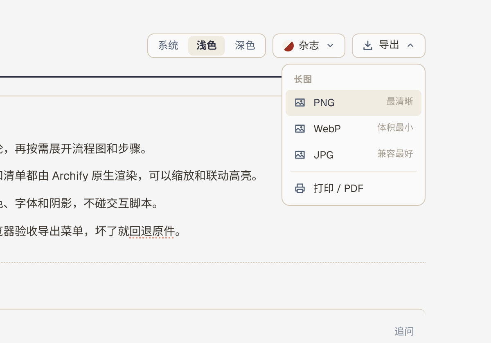
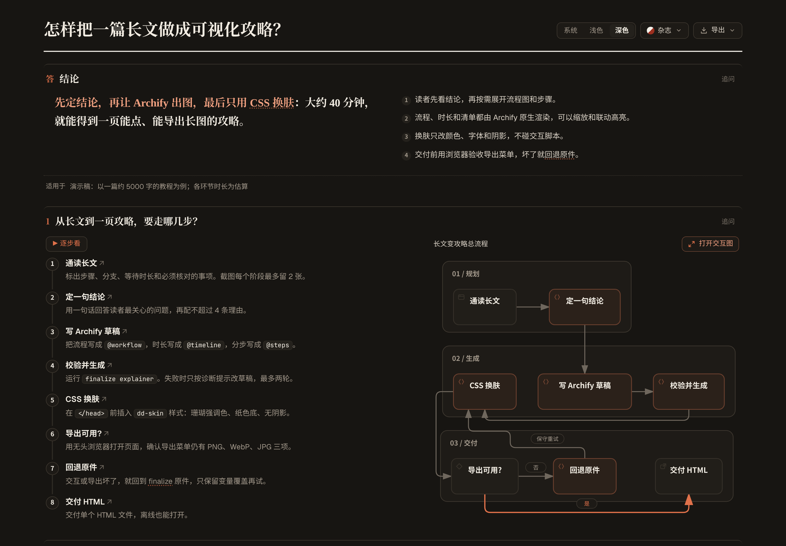
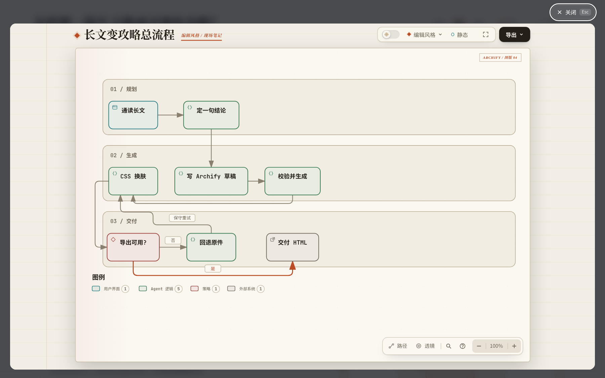
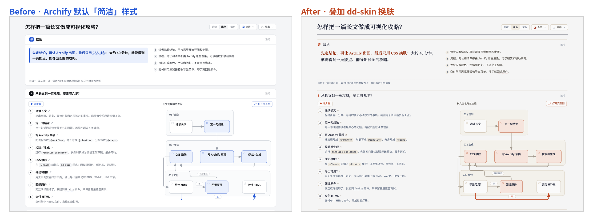
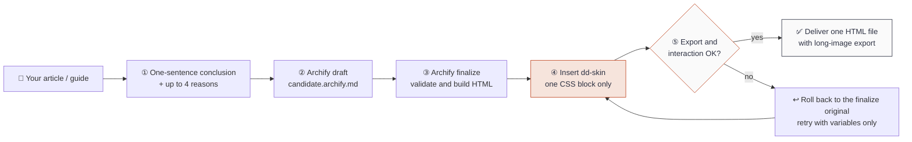
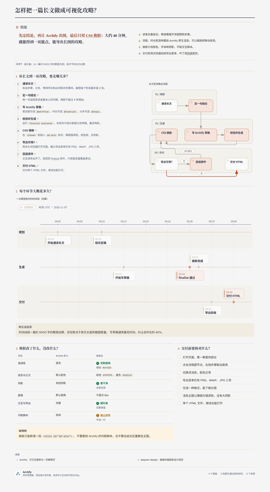

<div align="center">

# Guide Visualizer · archify-diagram-design

**Turn a long article, guide or tutorial into one interactive HTML page that your AI agent builds for you: clickable diagrams, light/dark themes, and long-image export.**

[](LICENSE)
[](SKILL.md)
[](#-install)
[](https://github.com/tt-a1i/archify)
[](CHANGELOG.md)

[中文](README.md) · English



<sub>A real screenshot of the bundled example. Open <a href="examples/longform-guide/longform-guide.html"><code>examples/longform-guide/longform-guide.html</code></a> to see the same page. The demo content is in Chinese.</sub>

</div>

---

## Contents

- [What is this?](#-what-is-this)
- [Features](#-features)
- [Before and after](#-before-and-after)
- [How it works](#-how-it-works)
- [Prerequisites](#-prerequisites)
- [Install](#-install)
- [Usage](#-usage)
- [Output](#-output)
- [Acceptance checklist](#-acceptance-checklist)
- [FAQ and troubleshooting](#-faq-and-troubleshooting)
- [Repository layout](#-repository-layout)
- [Credits](#-credits)
- [License](#-license)

## 💡 What is this?

An **Agent Skill** for AI coding assistants such as Codex, Claude Code and Cursor. A skill is a playbook the agent reads. Once installed, you say "turn this article into a one-page visual guide" and the agent follows the playbook step by step.

It combines two open-source skills, each with one job:

| Source | Responsible for |
| --- | --- |
| [**Archify**](https://github.com/tt-a1i/archify) | Page structure and interaction: conclusion first, clickable workflow / timeline / steps, light and dark themes, **PNG / WebP / JPG long-image export** |
| [**diagram-design**](https://github.com/cathrynlavery/diagram-design) | The skin only: coral accent `#bf4520`, paper background, ink text, no shadows, small radius, CJK-friendly fonts |

> **Hard rule: the skin must never break interaction or export.** The skin is one block of CSS; Archify's scripts stay untouched.

## ✨ Features

- **Conclusion first**: the first thing a reader sees is a one-sentence answer with up to four reasons.
- **Clickable diagrams**: steps and decisions (for example "Export works? yes / no") are real interactive diagrams with zoom, search and path exploration.
- **Step-through mode**: press "▶ 逐步看" (step through) and each step lights up its node in the diagram.
- **Timeline**: how long each stage takes, with estimates clearly marked as estimates.
- **Light / dark / system** themes.
- **Long-image export**: PNG (sharpest), WebP (smallest), JPG (most compatible), plus Print / PDF.
- **One self-contained HTML file**: no server, works offline, easy to share.
- **Restrained look**: coral only on the focal points and no shadows, instead of the default blue tech style.

<table>
<tr>
<td width="50%"><br><sub>Step-through: each step highlights its node</sub></td>
<td width="50%"><br><sub>The export menu survives the skin: PNG / WebP / JPG / Print</sub></td>
</tr>
<tr>
<td width="50%"><br><sub>Dark mode: only the accent changes; Archify keeps its dark palette</sub></td>
<td width="50%"><br><sub>"Open interactive diagram": full-screen viewer with zoom, search and paths</sub></td>
</tr>
</table>

## 🎨 Before and after

Left: Archify's default "clean" style (blue accent). Right: the same page with this skill's skin. Content, interaction and export are identical; only colors, fonts, shadows and radius change.



| Item | Archify default | After the skin |
| --- | --- | --- |
| Accent | Blue `#2457d6` ("clean" style) | Coral `#bf4520`, used sparingly |
| Background / text | Per-style palette | Paper `#f5f5f5` / ink `#2d3142` |
| Shadows | Light shadows | None |
| Radius | Default | At most 8px |
| Fonts | System fonts | Geist / Noto Sans SC / PingFang; serif headings |
| Interaction and export | Complete | **Fully preserved** |

## 🔧 How it works



In short: **Archify owns content and interaction, one CSS block owns the look, and export is always verified before delivery.**

## 🧰 Prerequisites

You need three things, each installed once.

### 1. Node.js 18 or newer

Archify's command-line tool runs on Node.js. Open a terminal (macOS: `Cmd + Space`, type "Terminal"; Windows: search for "PowerShell") and run:

```bash
node -v
```

If you see `v18.x.x` or higher, you are set. If the command is not found, install the **LTS** version from [nodejs.org](https://nodejs.org/) and open a new terminal.

### 2. An AI coding agent

Any one of these:

| Agent | Notes |
| --- | --- |
| [Codex](https://developers.openai.com/codex) (OpenAI) | CLI or app |
| [Claude Code](https://docs.anthropic.com/en/docs/claude-code) (Anthropic) | CLI |
| [Cursor](https://cursor.com/) | Agent chat |

Other agents that read Agent Skills (for example from `~/.agents/skills/`) usually work too.

### 3. The Archify skill (required)

```bash
npx skills add tt-a1i/archify -g
```

Archify usually lands in `~/.agents/skills/archify` (or `~/.claude/skills/archify`). This skill looks in those places automatically.

### 4. The diagram-design skill (optional)

This skill **bundles** a diagram-design-style skin in `assets/dd-skin.css`, so diagram-design is optional. Install it if you also want its standalone diagrams:

```bash
npx skills add cathrynlavery/diagram-design
```

## 📦 Install

### Option 1: one command (recommended)

```bash
# Codex (installs to ~/.agents/skills)
npx skills add bingomu/archify-diagram-design -g -a codex -y

# Claude Code (installs to ~/.claude/skills)
npx skills add bingomu/archify-diagram-design -g -a claude-code -y

# Cursor (installs to ~/.agents/skills)
npx skills add bingomu/archify-diagram-design -g -a cursor -y
```

When you see `✓ archify-diagram-design`, restart your agent so it reloads skills.

### Option 2: git clone

Pick **one** line:

```bash
# Shared location (read by Codex, Cursor and others)
git clone https://github.com/bingomu/archify-diagram-design ~/.agents/skills/archify-diagram-design

# Codex-specific directory
git clone https://github.com/bingomu/archify-diagram-design ~/.codex/skills/archify-diagram-design

# Claude Code
git clone https://github.com/bingomu/archify-diagram-design ~/.claude/skills/archify-diagram-design
```

No git? Use **Code → Download ZIP** on this page, unzip, rename the folder to `archify-diagram-design`, and move it into one of the directories above.

### Check the install

- Restart the agent and ask: "Can you use the archify-diagram-design skill?" It should describe what the skill does.
- Or check the files: `ls ~/.agents/skills/archify-diagram-design` (use `~/.claude/skills/...` for Claude Code) should list `SKILL.md`.

### Update

```bash
npx skills update archify-diagram-design -g
# or, for a git install:
cd ~/.agents/skills/archify-diagram-design && git pull
```

## 🚀 Usage

Give the agent the article (text, file path or link) and one sentence. Copy and adapt:

```text
Use the archify-diagram-design skill to turn this tutorial into a one-page visual guide:
conclusion first, the main process as a workflow diagram, a note for each step, and a checklist at the end.
Before delivering, verify that the export menu (PNG / WebP / JPG) still works.

<paste the article, or give a file path / link>
```

More examples:

```text
Turn ~/Downloads/getting-started.md into a one-page HTML guide that I can export as a long image.
```

```text
This guide has several "wait a few days" steps. Draw the waiting times as a timeline and mark the estimates.
```

The agent follows the five steps in [`SKILL.md`](SKILL.md): **conclusion → Archify draft → finalize → CSS skin → verify export and interaction**.

### Skin an existing Archify page yourself

```bash
node ~/.agents/skills/archify-diagram-design/scripts/apply-skin.mjs out.html skinned.html
```

The script only inserts one `<style id="dd-skin">` before `</head>` and **refuses to overwrite the input**, so you can always roll back.

## 📄 Output

```text
.archify/explainer-<topic>-<timestamp>/
├── candidate.archify.md   ← single source of content (the draft)
├── out.html               ← Archify finalize original (rollback target)
└── skinned.html           ← final skinned page (what you receive)
```

- The result is **one HTML file**; double-click to open it in a browser.
- "导出" (Export) at the top right produces a full-page long image. This is a real JPG export of the example page (downscaled):

<details>
<summary>📷 Show the exported long image</summary>



</details>

### Bundled example

[`examples/longform-guide/`](examples/longform-guide/), topic: "How to turn a long article into a visual guide" (in Chinese):

| File | What it is |
| --- | --- |
| [`candidate.archify.md`](examples/longform-guide/candidate.archify.md) | Archify draft showing `@workflow` (with a decision node), `@timeline`, `@steps`, a table, callouts and a checklist |
| [`longform-guide.html`](examples/longform-guide/longform-guide.html) | Final skinned page |
| [`longform-guide.archify-original.html`](examples/longform-guide/longform-guide.archify-original.html) | Archify original, for comparison |

> GitHub shows HTML files as source. **Download** the file and open it in a browser, or clone the repo.

## ✅ Acceptance checklist

The skill tells the agent to check these in a browser before delivery:

- [ ] The conclusion is visible on open
- [ ] Workflow and timeline diagrams zoom and highlight their steps
- [ ] Light and dark themes both look right
- [ ] The Export menu lists **PNG / WebP / JPG**
- [ ] At least one format downloads a long image
- [ ] Light theme uses coral for focus, not the blue tech look; no large shadows
- [ ] Estimates and source typos are labelled
- [ ] One HTML file that opens offline

The bundled example was checked in headless Chrome: all three export formats are listed and each one downloaded a long image; all 8 step-through steps highlighted their nodes; the diagram viewer opened; dark mode rendered correctly; no element on the page had a box shadow.

## ❓ FAQ and troubleshooting

<details>
<summary><b>After skinning, Export does nothing or the image is blank.</b></summary>

**Roll back to the finalize original** (`out.html`) and retry with only the most conservative color-variable overrides. Do not patch the page with static images. `scripts/apply-skin.mjs` always writes a new file, so the original is kept.
</details>

<details>
<summary><b>Dark mode shows a light background with unreadable text.</b></summary>

The skin put light variables on `:root`. Light variables belong only under `html[data-theme="light"], html:not([data-theme="dark"])`. The bundled `assets/dd-skin.css` already does this.
</details>

<details>
<summary><b>The agent cannot find Archify or <code>archify.mjs</code>.</b></summary>

Install it with `npx skills add tt-a1i/archify -g`, then check which of these exists: `~/.agents/skills/archify`, `~/.codex/skills/archify`, `~/.claude/skills/archify`. Tell the agent the actual path.
</details>

<details>
<summary><b><code>node: command not found</code></b></summary>

Node.js is missing, or the terminal was opened before the install. Install the LTS from [nodejs.org](https://nodejs.org/) and open a new terminal.
</details>

<details>
<summary><b>finalize fails.</b></summary>

Archify's diagnostics name the line, the problem and a repair. The skill tells the agent to apply only those repairs, for at most two rounds. Common causes: a bare `<`, `>` or `*` in prose (wrap it in backticks) or a table row with the wrong number of cells.
</details>

<details>
<summary><b>Can I use different colors?</b></summary>

Yes. Copy `assets/dd-skin.css`, change `--accent` and friends, then run `node scripts/apply-skin.mjs out.html skinned.html your-skin.css`. Re-check export afterwards.
</details>

<details>
<summary><b>When should I not use this skill?</b></summary>

- Deep code-architecture diagrams: use Archify's native diagrams directly.
- A single static poster with no interaction: use diagram-design directly.
- Dashboards: neither fits.
</details>

## 🗂 Repository layout

```text
archify-diagram-design/
├── SKILL.md                     # The skill: workflow and hard rules for the agent
├── assets/
│   └── dd-skin.css              # diagram-design-style skin (CSS only)
├── scripts/
│   └── apply-skin.mjs           # Inserts the skin into an Archify HTML file
├── examples/
│   └── longform-guide/          # Full example: draft + original + skinned page
├── docs/images/                 # Screenshots used in the README
├── README.md / README_EN.md     # Chinese / English docs
├── CHANGELOG.md
└── LICENSE                      # MIT
```

## 🙏 Credits

- [**Archify**](https://github.com/tt-a1i/archify) by tt-a1i (Apache-2.0): page structure, interactive diagrams, themes and long-image export. The HTML files in `examples/` embed the Archify runtime, which remains under Apache-2.0 and belongs to its authors.
- [**diagram-design**](https://github.com/cathrynlavery/diagram-design) by Cathryn Lavery (MIT): the visual language this skill borrows, including coral `#bf4520`, paper `#f5f5f5`, ink `#2d3142`, no shadows and "the best move is usually deletion".

This project is not affiliated with either project.

## 📜 License

This repository's own content (`SKILL.md`, `assets/`, `scripts/`, docs and the example draft) is released under the [MIT](LICENSE) license. Third-party parts keep their own licenses; see [Credits](#-credits).
